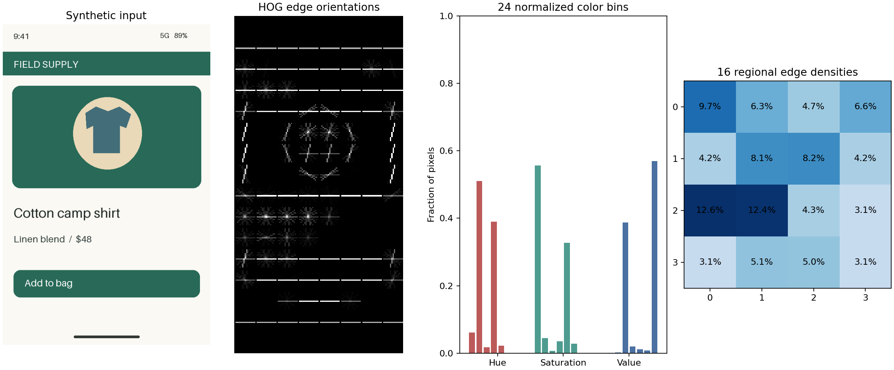

# Engineered image features

This pass adds three deterministic pixel descriptors to the existing eight-category classifier. It does not expand Enrico or change labels or partitions.

| Module | Inputs | Dimensions |
| --- | --- | ---: |
| HOG | Grayscale 128×256 portrait image; nine orientations, 16×16 cells, 2×2 blocks, L2-Hys | 3,780 |
| HSV histograms | Eight bins each for hue, saturation and value, excluding letterbox padding | 24 |
| Spatial edge density | Canny edges, fixed thresholds 100/200, L2 gradient; fractions in a 4×4 grid | 16 |
| All engineered image features | Concatenated blocks | 3,820 |

These modules do not use OCR, labels, source identifiers or a generative model. The HOG implementation is scikit-image's standard descriptor; OpenCV handles HSV conversion and Canny edges. Training fits a scaler on training images only, then L2-normalizes each visual block separately. This avoids weighting HOG more heavily solely because it has more columns. The existing text and CLIP pipeline is retained in fused comparisons.

## Measured outcome

Neither individual additions nor all three together beat the current classifier's validation macro F1 on either OCR backend. The prepared Mac and portable/Windows models remain unchanged. The implementations and separately fitted experimental artifacts remain available for comparisons; adding more dimensions is not itself an improvement.

See [complete results](reports/visual-study/REPORT.md), [Mac comparison](reports/visual-study/vision/REPORT.md) and [portable comparison](reports/visual-study/rapidocr/REPORT.md). All measured fits use the same 911/189 public train/validation records. Source-only test results cover 155 images in six supported classes; a separate 25-row test measures agreement with machine labels. Public validation includes pseudo-labels, so these comparisons remain exploratory.

## Install/update

After pulling the update, rerun `./setup.sh` on Mac, or `powershell -NoProfile -ExecutionPolicy Bypass -File .\setup.ps1` on Windows. The added CPU image-processing dependencies are pinned in the lock files. No extra large model, Qwen installation or API key is required.

## Repeat the study

On the prepared installation with its public annotation database and cached automatic features:

```sh
.venv/bin/python -m research.visual_study --no-synthetic
CLASSIFIER_OCR=rapidocr .venv/bin/python -m research.visual_study
```

On Windows, omit `CLASSIFIER_OCR=rapidocr` and use `.\.venv\Scripts\python.exe`. The default portable study also scores the existing synthetic test images if the synthetic corpus has been generated. They are transfer tests only and never enter training. A fresh clone does not include the public annotation database; rebuild/annotate a library before training. No external dataset was newly acquired for this study.

Normal `classifier train` also compares the new visual additions. `classifier predict` automatically computes the pixel blocks required by a fitted artifact. Pixel descriptors are independently versioned and cached as JSON under `data/pixel-features/`. An incompatible pixel feature version is rejected when loading an artifact. Original models remain compatible and do not pay for unused pixel extraction.

## Inspect an experimental model

After fitting the study locally, expand **Choose an image folder** in the app and choose **HOG visual experiment**, **All visual features experiment**, or **Engineered images only experiment**. The default remains the better-scoring prepared classifier.

An explicit portable-model example:

```powershell
.\.venv\Scripts\python.exe -m classifier predict "C:\path\to\screenshots" --model models/experiments/visual-study/rapidocr/fusion_char_visual/classifier.joblib
```

For a cold-cache workflow check after fitting an all-visual artifact, run `python -m research.verify_visual_install` using that environment's Python executable and matching OCR backend. It blocks Qwen and Python socket/DNS access, extracts real OCR, CLIP and pixel descriptors, checks all valid demo images and compares results after model reload. Native Windows execution still requires verification on a Windows machine.


