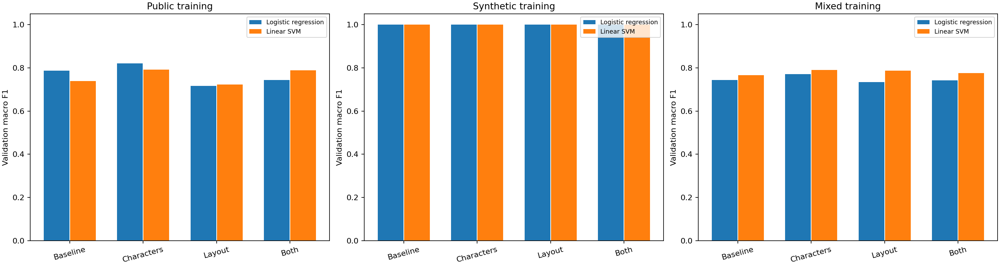

# Feature study: measured results

Added modules: character 3–5-gram TF-IDF (up to 1,500 columns) and 22 spatial OCR measurements. Both use the same automatically extracted OCR as the baseline. No extra large model or Qwen calls are used.

Generated **1,600 fictional screenshots**, 200 per category: **960 train / 320 validation / 320 test**. Exact image hashes and category/configuration groups do not cross partitions. The renderer and phrase banks are shared, so these are controlled synthetic tests rather than real-world accuracy measurements. See the [preview](synthetic-preview.jpg), [inventory](synthetic-inventory.json), [split manifest](synthetic-manifest.jsonl) (paths relative to `data/synthetic-screens/`) and [generator](../../research/synthetic_screens.py).

## Portable/Windows OCR pipeline

The public-validation column uses the better validation result of logistic regression and SVM for each feature condition. The synthetic-test column consistently uses synthetic-only logistic regression so its feature comparison holds the algorithm fixed. Validation, not test accuracy, selects deployed models.

| Feature condition | Best public-validation algorithm | Public validation macro F1 | Synthetic-only LR test accuracy |
|---|---|---:|---:|
| Baseline | Logistic regression | 0.787 | 99.4% |
| Characters | Logistic regression | 0.821 | 100.0% |
| Layout | Linear SVM | 0.723 | 99.4% |
| Characters + layout | Linear SVM | 0.788 | 100.0% |

The public-data character model improved validation macro F1 from **0.787 to 0.821**. On the unchanged, exploratory 155-image source-labeled holdout (six supported categories), its accuracy was **143/155 = 92.3%**, versus **140/155 = 90.3%** for the prepared baseline. Public validation includes 37 machine labels; this is not independent eight-category accuracy.

## What the synthetic run tells us

The selected synthetic-only model was baseline logistic regression: every condition achieved 1.000 validation macro F1, so the predefined smaller-vector tie-break kept baseline. Its held-out synthetic accuracy was **318/320 = 99.4%**. Character additions correctly classified 320/320 in the planned test comparison, but that test score did not choose the winner.

The selected synthetic-only model achieved only **45/155 = 29.0%** accuracy on the public source holdout. This exposes a large synthetic-to-real domain gap. High synthetic scores are not evidence that the app will classify real screenshots reliably.

Training on public plus synthetic images selected character features with SVM: public validation macro F1 **0.790**, below the public-only **0.821**. The public-only model therefore remains the prepared classifier. Mixed and synthetic-only models are retained as separate experiments.

## Mac OCR pipeline

On the same public partitions, character features improved validation macro F1 from **0.762 to 0.819**. Source-only holdout accuracy increased from **139/155 to 141/155 (91.0%)**. Layout alone and the combined condition did not beat the character-only validation winner. The prepared Mac classifier also uses the public-only character model.

## Working folder demo

A separate 40-image folder was copied from synthetic test configurations (five per category), with zero training-image overlap. The selected synthetic model got **40/40 raw category predictions correct**. Production confidence/rule routing displayed **36/40 matching categories** and sent four uncertain predictions to Miscellaneous. The dataset labels still come from the generator; these are not real-image accuracy claims. [Demo evidence](rapidocr/demo-check.json)

## Checks and complete results

All 32 planned public/synthetic/mixed model fits across the two OCR pipelines converged after the solver iteration limit was increased; the maximum observed count was 5,106. Saved-model reload predictions match. Public source test matrices replay unchanged after publishing the character winners. Both prepared models preserve the original source/pseudo labels and contain no synthetic training images.

- [Portable full comparison](rapidocr/REPORT.md) and [complete metrics](rapidocr/results.json)
- [Mac public comparison](vision/REPORT.md) and [complete metrics](vision/results.json)
- [Reproduce the experiment](../../FEATURE_STUDY.md)
- Local holdout demo folder: `demo-synthetic-unseen/`

