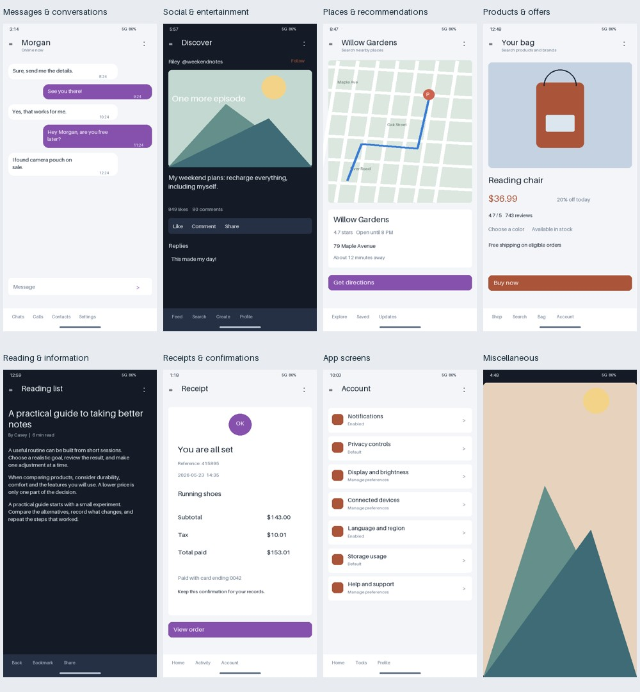

# Character and OCR-layout feature study

Backend: **rapidocr**. Seed 513. Character features use train-fitted character 3–5-gram TF-IDF (up to 1,500 columns); layout adds 22 train-standardized spatial measurements from automatic OCR boxes. Baseline is word TF-IDF + 15 numeric features + frozen CLIP. No Qwen or network calls were allowed during extraction, training or evaluation.

## Planned comparison

All four feature conditions use identical partitions and fixed classifier settings. When present, Public and Mixed models are selected on the same 189-row public validation set; Synthetic models use synthetic validation. Thresholds use the tenth percentile of correct validation margins. Test measurements do not select models. The prepared public source test includes 155 rows across six supported categories; 25 machine-labeled rows are measured separately in results.json. The source-test column below averages over supported classes only. Synthetic test covers all eight classes. A synthetic-only run does not evaluate public data.

| Training corpus | Features | Algorithm | Columns | Validation macro F1 | Public source test supported F1 | Synthetic test macro F1 |
|---|---|---|---:|---:|---:|---:|
| Public | Baseline | Logistic regression | 3527 | 0.787 | 0.883 | 0.358 |
| Public | Baseline | Linear SVM | 3527 | 0.739 | 0.905 | 0.496 |
| Public | Characters | Logistic regression | 5027 | 0.821 | 0.904 | 0.533 |
| Public | Characters | Linear SVM | 5027 | 0.792 | 0.929 | 0.582 |
| Public | Layout | Logistic regression | 3549 | 0.717 | 0.860 | 0.417 |
| Public | Layout | Linear SVM | 3549 | 0.723 | 0.872 | 0.472 |
| Public | Characters + layout | Logistic regression | 5049 | 0.744 | 0.862 | 0.421 |
| Public | Characters + layout | Linear SVM | 5049 | 0.788 | 0.885 | 0.576 |
| Synthetic | Baseline | Logistic regression | 3527 | 1.000 | 0.271 | 0.994 |
| Synthetic | Baseline | Linear SVM | 3527 | 1.000 | 0.299 | 1.000 |
| Synthetic | Characters | Logistic regression | 5027 | 1.000 | 0.307 | 1.000 |
| Synthetic | Characters | Linear SVM | 5027 | 1.000 | 0.443 | 1.000 |
| Synthetic | Layout | Logistic regression | 3549 | 1.000 | 0.217 | 0.994 |
| Synthetic | Layout | Linear SVM | 3549 | 1.000 | 0.109 | 1.000 |
| Synthetic | Characters + layout | Logistic regression | 5049 | 1.000 | 0.231 | 1.000 |
| Synthetic | Characters + layout | Linear SVM | 5049 | 1.000 | 0.170 | 1.000 |
| Mixed | Baseline | Logistic regression | 3527 | 0.744 | 0.871 | 1.000 |
| Mixed | Baseline | Linear SVM | 3527 | 0.766 | 0.907 | 1.000 |
| Mixed | Characters | Logistic regression | 5027 | 0.771 | 0.854 | 1.000 |
| Mixed | Characters | Linear SVM | 5027 | 0.790 | 0.920 | 1.000 |
| Mixed | Layout | Logistic regression | 3549 | 0.734 | 0.810 | 1.000 |
| Mixed | Layout | Linear SVM | 3549 | 0.787 | 0.900 | 1.000 |
| Mixed | Characters + layout | Logistic regression | 5049 | 0.742 | 0.812 | 1.000 |
| Mixed | Characters + layout | Linear SVM | 5049 | 0.775 | 0.899 | 1.000 |

## Synthetic corpus

1600 fictional UI captures, 200 per category. Split counts: {'train': 960, 'validation': 320, 'test': 320}. There are 80 category/configuration groups. Families 0–5 are training, 6–7 validation and 8–9 test. Configuration groups and exact image hashes do not cross partitions. Screens vary device dimensions, padding, alignment, colors, dark/light themes, text, prices and illustrated content. Category labels come directly from the generator. Text, group IDs, filenames and label metadata never enter X except text re-extracted from image pixels by OCR.

The renderer resembles phone interfaces, but its shared drawing logic and phrase banks make this an easier, artificial distribution. Neither a high synthetic score nor an improvement from synthetic augmentation establishes accuracy on real screenshots. The public source test and teacher-agreement limitations still apply.

## Selected models

- **Public:** Logistic regression / Characters; validation macro F1 0.821. Local artifact: `models/experiments/feature-study/rapidocr/public/classifier.joblib`. Reload predictions identical.
- **Synthetic:** Logistic regression / Baseline; validation macro F1 1.000. Local artifact: `models/experiments/feature-study/rapidocr/synthetic/classifier.joblib`. Reload predictions identical.
- **Mixed:** Linear SVM / Characters; validation macro F1 0.790. Local artifact: `models/experiments/feature-study/rapidocr/mixed/classifier.joblib`. Reload predictions identical.

## Limits

- Synthetic labels describe generator intent, not independent human review.
- Held-out synthetic configurations share drawing code and phrase banks.
- Public validation includes Qwen pseudo-labels; source-only and teacher test rows are separate.
- Existing public tests have been inspected previously; all results are exploratory.

Complete matrices, per-class results, teacher agreement and timings are in [results.json](results.json). Production content rules are excluded from these classifier metrics.
