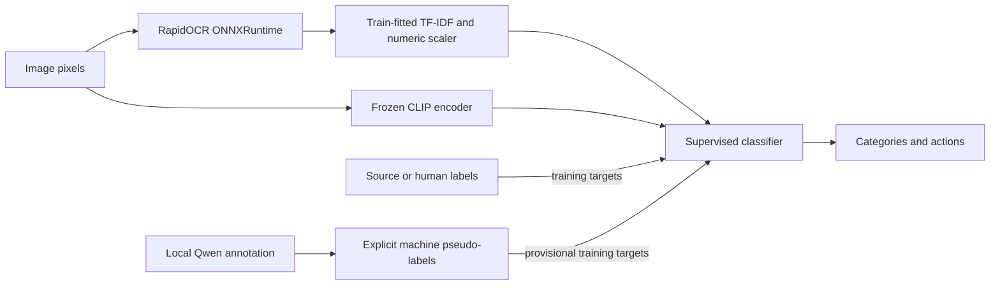
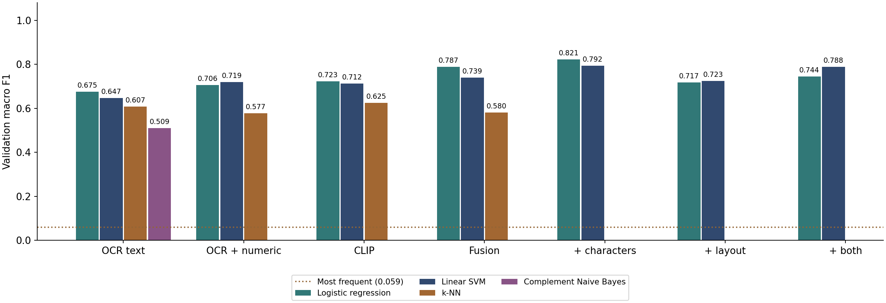
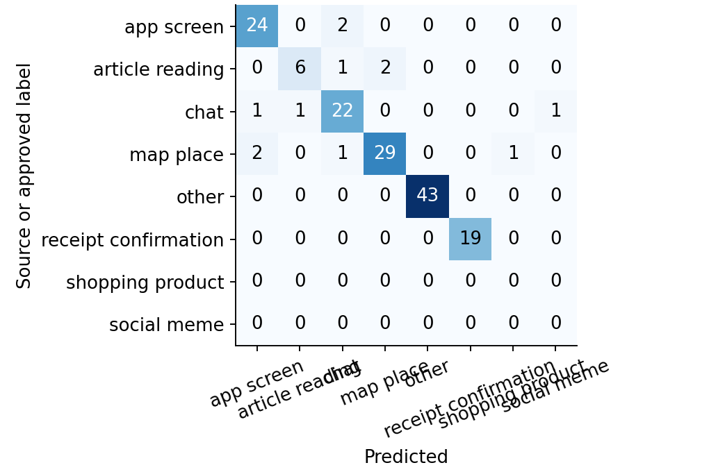
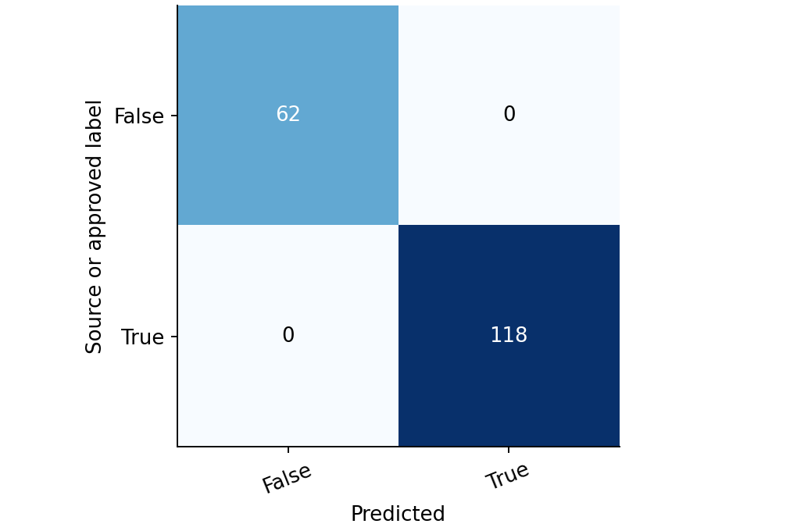

# Screenshot Intelligence · CS 513-B

Can a small supervised classifier recognize the content of a saved screenshot? Does joining OCR and visual features help? A second question concerns why the owner saved it. Only the owner can supply that training target.

## Findings

The validation winner was Logistic regression with fusion_char features (macro F1 0.821). The best fused classifier scored 0.787 on the same validation images. The tables give pre-routing predictions and performance after applying the validation margin cutoff. Each task is evaluated independently on its eligible records. Deployment uses content confidence and optional OCR rules, then assigns remaining uncertainty to Miscellaneous.

## Data and independence

The study contains 1280 eligible canonical images. Source counts are {'masc': 743, 'enrico': 58, 'tf_flowers': 360, 'cord': 119}. The separate demonstration library contributed 9 excluded fixtures. The public sample maps MASC Chat, Map and Setting to conversations, places and app screens. Enrico news supplies reading screens. Source labels describe screen function, which can differ from the dominant content a human would choose. The negative examples are photographs from TensorFlow Flowers. Individual photographer, license and source URL are retained in the private manifest.

The expanded experiment learns 8 content categories. Additional public MASC candidates were selected using UI hierarchy text, then annotated from their pixels by local Qwen. Hierarchy text and metadata never enter classifier features. CORD supplies real receipt images with source labels under CC BY 4.0. Ordinary flower photos map to Miscellaneous. Content targets now apply independently of capture status. Training label origins are {'source': 762, 'pseudo': 149}. Validation origins are {'source': 152, 'pseudo': 37}. Qwen-labeled validation measures provisional agreement with machine annotations. Source-only test metrics and held-out machine-label agreement are distinguished. Owner purpose/usefulness remain unknown. The acquisition and annotation inventory is in [expansion.json](../expansion.json). Previous experiments are backed up in data/backups/.

| Content | Train | Validation | Public test | Personal test |
|---|---|---|---|---|
| app_screen | 183 | 45 | 26 | 0 |
| article_reading | 45 | 10 | 9 | 0 |
| chat | 121 | 29 | 25 | 0 |
| map_place | 144 | 16 | 33 | 0 |
| other | 258 | 59 | 43 | 0 |
| receipt_confirmation | 85 | 15 | 19 | 0 |
| shopping_product | 41 | 9 | 0 | 0 |
| social_meme | 34 | 6 | 0 | 0 |

Split sizes are {'train': 911, 'validation': 189, 'test_public': 180}. The combined app, photographer and duplicate groups per partition are {'train': 749, 'validation': 150, 'test_public': 147}. Overlapping groups across partitions: 0. Exact byte matches retain alternate source IDs. Near matches share a group if their aspect ratios are within 3%, 64-bit difference hashes differ by at most four bits, and 8×8 RGB mean absolute difference is at most seven. This groups candidates conservatively. Unidentified crops may survive. Rico IDs are linked across sources. Seed 513 assigns up to seven stratified group folds, reserving one for validation and one for test. Final group assignments and frozen test labels are stored locally.

## Method

RapidOCR ONNXRuntime 1.4.4 reads the complete oriented image with its checksum-verified PP-OCRv4 models on CPU. Tall images use overlapping tiles. CLIP ViT-B/32 uses a fixed quantized ONNX checkpoint, aspect-preserving padding, and L2-normalized 512-dimensional image embeddings. The OCR condition includes 15 numeric features and up to 3,000 word unigrams/bigrams. The text-only condition contains nonnegative TF-IDF features and supports Complement Naive Bayes. The training set determines vocabulary, IDF and standardization. No owner, file name, app ID, Qwen description, suggested action, corrected transcript or human label enters the input matrix. Qwen assists annotation. The supervised classifiers are the project contribution.

Additional conditions add train-fitted character 3–5-gram TF-IDF (up to 1,500 columns), 22 standardized OCR spatial measurements, or both. Layout uses only automatic text boxes: a 3×3 position histogram, left/center/right proportions, box-size statistics, vertical position/span, line gaps and OCR confidence. These experiments are documented separately in the feature-study report. The deployed public-study winner contains no synthetic training images.

Logistic regression and linear SVM use class weighting and default regularization C=1. k-NN uses five neighbors, cosine distance, and distance-weighted voting. Complement Naive Bayes uses alpha=1 and OCR text only. These are fixed initial settings. Selection maximizes validation macro F1, with smaller dimensionality then fixed candidate order breaking ties. The routing cutoff is the tenth percentile of margins among correct validation predictions. For SVM and logistic regression the margin is computed from decision scores. For k-NN and Naive Bayes it is the difference between the two highest class outputs, whose calibration has not been verified. Empty OCR is a valid observed feature. Extraction errors abstain and can be retried.

## Algorithm and modality comparison

| Algorithm | Features | Columns | Validation accuracy | Validation macro F1 |
|---|---|---|---|---|
| Most frequent | ocr | 3015 | 0.312 | 0.059 |
| Logistic regression | ocr | 3015 | 0.794 | 0.706 |
| Linear SVM | ocr | 3015 | 0.810 | 0.719 |
| k-NN | ocr | 3015 | 0.746 | 0.577 |
| Logistic regression | clip | 512 | 0.836 | 0.723 |
| Linear SVM | clip | 512 | 0.825 | 0.712 |
| k-NN | clip | 512 | 0.794 | 0.625 |
| Logistic regression | fusion | 3527 | 0.868 | 0.787 |
| Linear SVM | fusion | 3527 | 0.841 | 0.739 |
| k-NN | fusion | 3527 | 0.762 | 0.580 |
| Logistic regression | text | 3000 | 0.751 | 0.675 |
| Linear SVM | text | 3000 | 0.741 | 0.647 |
| k-NN | text | 3000 | 0.730 | 0.607 |
| Complement Naive Bayes | text | 3000 | 0.492 | 0.509 |
| Logistic regression | fusion_char | 5027 | 0.878 | 0.821 |
| Linear SVM | fusion_char | 5027 | 0.862 | 0.792 |
| Logistic regression | fusion_layout | 3549 | 0.799 | 0.717 |
| Linear SVM | fusion_layout | 3549 | 0.820 | 0.723 |
| Logistic regression | fusion_char_layout | 5049 | 0.820 | 0.744 |
| Linear SVM | fusion_char_layout | 5049 | 0.847 | 0.788 |

## Current deployment behavior

The eight-category content policy runs the trained content classifier for every decodable image. Confident predictions from the complete supervised head take priority. Screenshot detection is recorded as advisory metadata and cannot block a content prediction. Strong OCR cues can identify message composers, product purchase offers, confirmed payments, issued tickets, restaurant menus, maps and game entertainment. Uncertain content goes to Miscellaneous. Decode or feature-extraction failures retain a separate Processing error state.

Local OCR rules assist uncertain model decisions. Shopping, confirmations, entertainment and Miscellaneous are also learned labels when present in the training data. They remain explicit in each saved prediction through `category_source` and `content_rule`. They use automatic pixel-derived OCR and generic patterns. The fresh images remain outside training. Development examples were inspected to repair this policy, so the aggregate before/after counts in [routing-check.json](../routing-check.json) demonstrate routing coverage. They do not measure independent classification accuracy. The test results below evaluate the saved supervised heads and retain their original meaning.

## Frozen test results

| Task | Partition | N | Accuracy | Macro F1 | Weighted F1 | Accepted | Accepted accuracy |
|---|---|---|---|---|---|---|---|
| content_type | test_public | 155 | 0.923 | 0.678 | 0.928 | 141/155 | 0.950 |
| is_screenshot | test_public | 180 | 1.000 | 1.000 | 1.000 | 164/180 | 1.000 |

| Task | Partition | Class | Precision | Recall | F1 | Support |
|---|---|---|---|---|---|---|
| content_type | test_public | app_screen | 0.889 | 0.923 | 0.906 | 26 |
| content_type | test_public | article_reading | 0.857 | 0.667 | 0.750 | 9 |
| content_type | test_public | chat | 0.846 | 0.880 | 0.863 | 25 |
| content_type | test_public | map_place | 0.935 | 0.879 | 0.906 | 33 |
| content_type | test_public | other | 1.000 | 1.000 | 1.000 | 43 |
| content_type | test_public | receipt_confirmation | 1.000 | 1.000 | 1.000 | 19 |
| content_type | test_public | shopping_product | 0.000 | 0.000 | 0.000 | 0 |
| content_type | test_public | social_meme | 0.000 | 0.000 | 0.000 | 0 |
| is_screenshot | test_public | False | 1.000 | 1.000 | 1.000 | 62 |
| is_screenshot | test_public | True | 1.000 | 1.000 | 1.000 | 118 |

Median feature latency on this Mac was 766.1 ms for OCR and 19.2 ms for CLIP. These include per-image preparation inside each extractor and concurrent dataset processing. The cached features retain individual times. Model-only batch timings, coverage, accepted-only F1 and detailed validation matrices for both tasks are in [results.json](results.json).

## Held-out machine-label agreement

These rows use machine-generated targets and provide a provisional teacher-agreement check. They are excluded from the source-only test table.

| Task | Machine-labeled rows | Agreement accuracy | Agreement macro F1 |
|---|---|---|---|
| content_type | 25 | 0.640 | 0.262 |

## Interpretation and limits

The supervised head contains 8 trained categories. Some newly added categories rely on Qwen pseudo-labels, so teacher errors can propagate into training. CORD receipts are photographs with a different visual style from phone payment confirmations. Miscellaneous includes ordinary photographs and remains a broad heterogeneous category. A closed-set model can confidently assign an unsupported image to a known class. Class margins do not solve open-set recognition. Reading examples come from one source and their test support is small. The detector can exploit image dimensions, source style and flower imagery. Its public score does not establish accuracy on a mixed personal phone library. The blank-crop and portrait demonstration includes uncertain routes.

There are no independently blind human labels covering all categories. A source-only test score measures agreement with dataset mappings for its supported classes. Provisional validation and a separately reported held-out machine-label comparison use Qwen pseudo-labels. Their scores measure teacher agreement. Macro F1 over all trained labels penalizes unsupported test classes with zero scores, while supported_macro_f1 in results.json restricts averaging to classes with test support. Earlier public data have been inspected, and this expanded study uses newly grouped splits. It is exploratory. Fresh independent labels across all eight categories are needed for a confirmatory accuracy claim. No owner-confirmed purpose or usefulness labels were supplied. The course team-size requirement is 3–4.

## Sample records and references

A public record may contain `source.dataset=masc` within an origin, `labels.content_type=chat`, `target_provenance.content_type.origin=source` and `labels.purpose=null`. The validated sample file contains actual records reduced to public identifiers, targets and splits. Private images, OCR and drafts stay in the local export.

- Girgis et al. (2025), MASC dataset and mapping. [Authors’ repository](https://github.com/Ali-Aahmed/MASC-Dataset)
- Leiva, Hota and Oulasvirta (2020), Enrico, derived from Rico. [Authors’ dataset](https://userinterfaces.aalto.fi/enrico/)
- Park et al., CORD receipt data. [Authors’ release](https://github.com/clovaai/cord) and [training data](https://huggingface.co/datasets/naver-clova-ix/cord-v2)
- TensorFlow Team, Flowers. [Dataset and attribution](https://www.tensorflow.org/datasets/catalog/tf_flowers)
- Radford et al. (2021), CLIP. [Original paper](https://proceedings.mlr.press/v139/radford21a.html) and [quantized checkpoint](https://huggingface.co/Xenova/clip-vit-base-patch32/blob/main/onnx/vision_model_quantized.onnx)
- Apple, Vision text recognition. [Documentation](https://developer.apple.com/documentation/vision/recognizing-text-in-images)
- scikit-learn, feature extraction and linear classifiers. [Documentation](https://scikit-learn.org/stable/modules/feature_extraction.html)
- scikit-learn, nearest-neighbor and Naive Bayes classification. [k-NN](https://scikit-learn.org/stable/modules/neighbors.html) and [Naive Bayes](https://scikit-learn.org/stable/modules/naive_bayes.html)
- Ollama, Qwen3-VL 4B Instruct and structured outputs. [Model](https://ollama.com/library/qwen3-vl:4b-instruct) and [API](https://docs.ollama.com/capabilities/structured-outputs)
