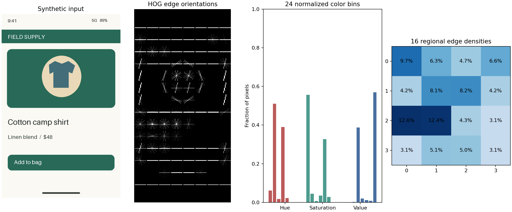
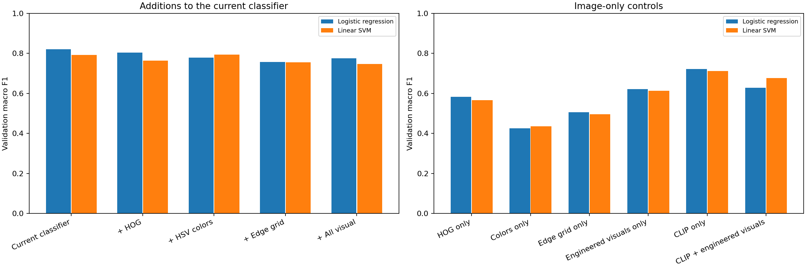

# Engineered visual features: results

Added and evaluated **3,780 HOG values, 24 HSV histogram values and 16 regional edge densities**, all extracted directly from pixels. These total 3,820 engineered visual inputs. Enrico, the taxonomy, labels and public partitions were not expanded. Text and CLIP remain fixed in the baseline/addition comparisons.

## Did they improve the classifier?

**No visual addition beat the current validation winner on either OCR backend.** Prepared models remain unchanged. Each cell below uses the better validation result of logistic regression and linear SVM for that feature condition. Hyperparameters are fixed and test results do not choose a model.

| Features | Mac/Vision validation macro F1 | Portable/RapidOCR validation macro F1 |
|---|---|---|
| Current classifier | 0.819 (Logistic regression) | 0.821 (Logistic regression) |
| + HOG | 0.808 (Logistic regression) | 0.804 (Logistic regression) |
| + HSV colors | 0.803 (Logistic regression) | 0.794 (Linear SVM) |
| + Edge grid | 0.794 (Linear SVM) | 0.757 (Logistic regression) |
| + All visual | 0.766 (Linear SVM) | 0.776 (Logistic regression) |

On the portable pipeline, engineered image features alone reached **0.621** validation macro F1; CLIP alone reached **0.723**, while the current text + CLIP model reached **0.821**. These results show that the engineered features contain signal, but do not establish new information that improves the already stronger fused model with these settings. More correlated inputs and limited labeled examples can hurt validation performance. That is an interpretation, not a measured causal explanation.

All candidates used **911 training and 189 validation images**, including 37 machine-labeled validation targets. Source-only holdout results cover 155 images in six supported classes; the separate 25-image machine-label comparison is teacher agreement. These previously inspected public data support exploratory comparisons, not independently established eight-category accuracy. Synthetic images were optional transfer tests only, never training data.

## What is implemented?

- Versioned, cached HOG, HSV histograms and spatial Canny-edge measurements.
- Train-only preprocessing and per-block normalization.
- Image-only controls and fused additions, with 22 model fits per OCR backend.
- Separate experimental artifacts for each condition, plus the validation-selected candidate.
- Automatic extraction during classification when the chosen model requires pixels.
- Saved-artifact compatibility checks and cold-cache offline inference checks.

Both pipelines passed **51 regression tests**. All 44 planned fits converged. The full visual models use 8,847 inputs; pure engineered-image models use 3,820. Models and measurements were tested on macOS; native Windows setup remains unverified. The Windows dependency set resolves with binary wheels.

[Portable full metrics](rapidocr/results.json) · [Mac full metrics](vision/results.json) · [How to run](../../VISUAL_FEATURES.md)

