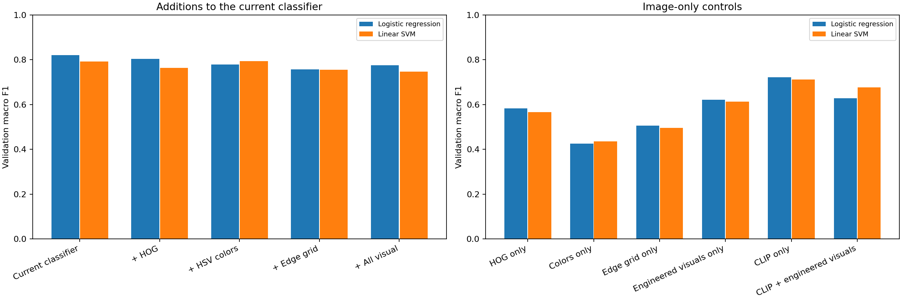

# Engineered visual feature study

Backend: rapidocr; host: Darwin arm64; seed 513. No Enrico expansion or new datasets were used. All candidates use the existing eight-category public corpus and the same frozen app/duplicate groups: 911 train, 189 validation, 155 source-labeled test rows and 25 machine-labeled test rows. Zero tracked group overlap. Public validation includes machine labels. Scores remain exploratory because public data have been inspected previously.

## Pixel descriptors

- **HOG: 3,780** values. Grayscale 128×256 aspect-preserving portrait canvas, neutral padding, 16×16 cells, 2×2-cell blocks, nine orientations, L2-Hys normalization.
- **HSV colors: 24** values. Eight bins per channel from an unpadded thumbnail; each channel histogram sums to one.
- **Edge grid: 16** values. Canny thresholds 100/200, L2 gradient, a 4×4 grid containing edge-pixel proportions.

These descriptors use no OCR, annotations, file names, app IDs or learned model. Train-fitted standardization followed by L2 normalization per descriptor block keeps the 3,780-dimensional HOG block from dominating simply through its size. Pixel extraction has a separate versioned cache. Median initial descriptor extraction on this Mac: **8.98 ms** per image (decoding/cache I/O not included).

The baseline is the current word/character TF-IDF + numeric + CLIP model. Its text pipeline stays fixed. Pure engineered-image and CLIP candidates are diagnostic controls. The selected deployment candidate is chosen only from baseline and its visual additions, using validation macro F1 then fewer columns. Test metrics do not select the model. Synthetic screenshots, when available, are transfer tests only and never enter training.

| Features | Algorithm | Columns | Validation macro F1 | Source-test accuracy | Source-test supported F1 | Synthetic-transfer accuracy |
|---|---|---:|---:|---:|---:|---:|
| Current classifier | Logistic regression | 5027 | 0.821 | 0.923 | 0.904 | 0.622 |
| Current classifier | Linear SVM | 5027 | 0.792 | 0.948 | 0.929 | 0.662 |
| + HOG | Logistic regression | 8807 | 0.804 | 0.929 | 0.916 | 0.562 |
| + HOG | Linear SVM | 8807 | 0.763 | 0.935 | 0.917 | 0.597 |
| + HSV colors | Logistic regression | 5051 | 0.779 | 0.897 | 0.880 | 0.344 |
| + HSV colors | Linear SVM | 5051 | 0.794 | 0.923 | 0.903 | 0.575 |
| + Edge grid | Logistic regression | 5043 | 0.757 | 0.903 | 0.876 | 0.566 |
| + Edge grid | Linear SVM | 5043 | 0.755 | 0.935 | 0.917 | 0.531 |
| + All visual | Logistic regression | 8847 | 0.776 | 0.890 | 0.871 | 0.378 |
| + All visual | Linear SVM | 8847 | 0.748 | 0.923 | 0.905 | 0.522 |
| HOG only | Logistic regression | 3780 | 0.583 | 0.819 | 0.800 | 0.125 |
| HOG only | Linear SVM | 3780 | 0.567 | 0.845 | 0.826 | 0.194 |
| Colors only | Logistic regression | 24 | 0.425 | 0.568 | 0.540 | 0.125 |
| Colors only | Linear SVM | 24 | 0.436 | 0.626 | 0.563 | 0.066 |
| Edge grid only | Logistic regression | 16 | 0.505 | 0.761 | 0.760 | 0.209 |
| Edge grid only | Linear SVM | 16 | 0.495 | 0.774 | 0.759 | 0.222 |
| Engineered visuals only | Logistic regression | 3820 | 0.621 | 0.858 | 0.853 | 0.125 |
| Engineered visuals only | Linear SVM | 3820 | 0.614 | 0.865 | 0.846 | 0.128 |
| CLIP only | Logistic regression | 512 | 0.723 | 0.910 | 0.895 | 0.472 |
| CLIP only | Linear SVM | 512 | 0.712 | 0.890 | 0.867 | 0.494 |
| CLIP + engineered visuals | Logistic regression | 4332 | 0.628 | 0.916 | 0.912 | 0.266 |
| CLIP + engineered visuals | Linear SVM | 4332 | 0.677 | 0.910 | 0.902 | 0.312 |

## Selected candidate

**Current classifier / Logistic regression**, 5027 columns; validation macro F1 **0.821**. Artifact: `models/experiments/visual-study/rapidocr/classifier.joblib`. Reload predictions are identical. All fits converged. Qwen calls and Python network connections were blocked.

The source test has six source-supported categories; shopping and entertainment lack independent test labels. Machine-label test agreement is reported separately in results.json. The synthetic-transfer images share renderer logic and are not an independent real-image benchmark. No source-only score establishes broad eight-category accuracy. Model metrics precede confidence routing and OCR rules.

